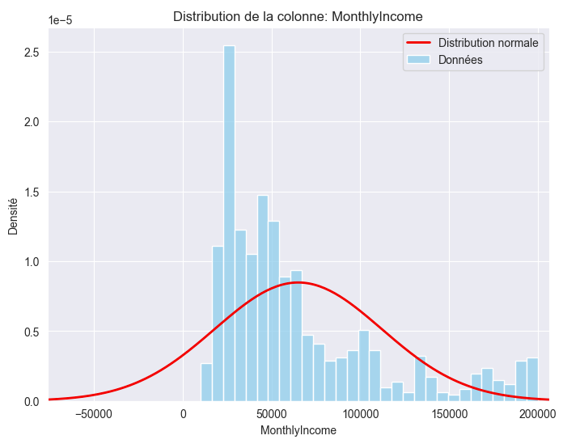
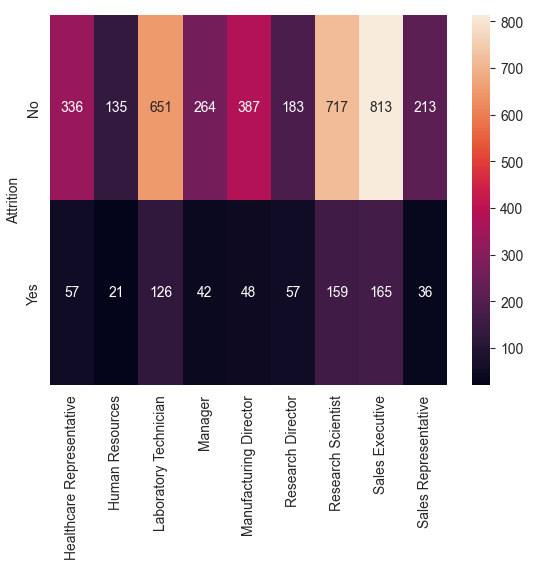
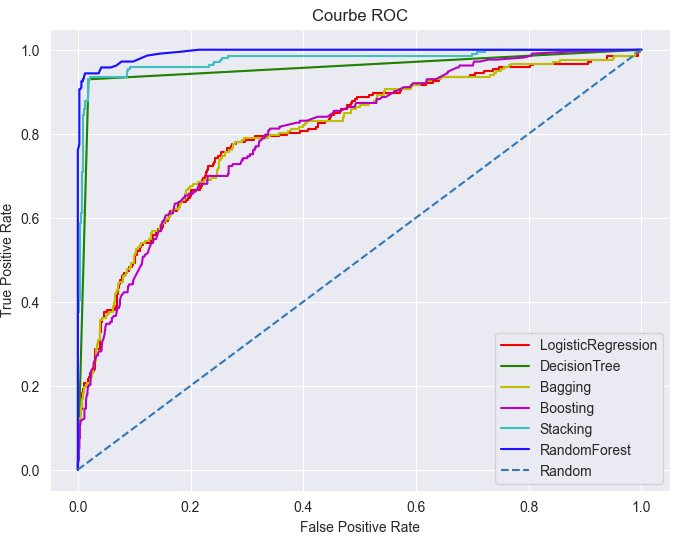

# 📉 HR Analytics: Employee Attrition Prediction - test

[](https://www.python.org/)
[](https://jupyter.org/)
[](https://scikit-learn.org/)
[](LICENSE)

> **A data-driven approach to understanding workforce dynamics. This project leverages Machine Learning to predict employee turnover and identify key retention factors.**

---

## 📑 Table of Contents
- [💼 Business Context](#-business-context)
- [📊 Data Science Pipeline](#-data-science-pipeline)
- [🧠 Models & Methodology](#-models--methodology)
- [📈 Key Insights & Results](#-key-insights--results)
- [💻 Installation & Usage](#-installation--usage)
- [📂 Project Structure](#-project-structure)

---

## 💼 Business Context

Employee attrition (turnover) is a critical issue for modern organizations. Replacing an employee can cost **up to 200%** of their annual salary.
**The Goal:** Build a predictive model to identify employees at risk of leaving *before* they resign.

**Objectives:**
1.  **Predict:** Classify employees as "likely to leave" or "likely to stay".
2.  **Explain:** Determine the root causes of attrition (e.g., Salary, OverTime, Distance from Home).
3.  **Act:** Provide actionable insights for HR teams to improve retention strategies.

---

## 📊 Data Science Pipeline

This repository follows a rigorous industry-standard workflow:

### 1. Exploratory Data Analysis (EDA)
Understanding the dataset distribution and identifying correlations.

<p align="center">
  
  <br>
  <em>Figure: Distribution of the Monthly Income column as an example.</em>
</p>
<p align="center">
  
  <br>
  <em>Figure: Attrition Heatmap by department as an example.</em>
</p>

### 2. Preprocessing & Feature Engineering
* **Encoding:** Handling categorical variables (Business Travel, Department, etc.).
* **Scaling:** Normalizing numerical features for distance-based algorithms.
* **Balancing:** Addressing class imbalance (Attrition is usually a minority class) using techniques like **SMOTE** (Synthetic Minority Over-sampling Technique).

---

## 🧠 Models & Methodology

We experimented with several algorithms to find the best balance between Precision and Recall.

| Algorithm | Why use it? |
| :--- | :--- |
| **Logistic Regression** | Great baseline for interpretability (feature coefficients). |
| **Random Forest** | Robust against overfitting and provides Feature Importance. |
| **Support Vector Machine (SVM)** | Effective for high-dimensional spaces. |
| **XGBoost / Gradient Boosting** | High-performance model for maximizing accuracy. |

**Evaluation Metrics:**
Since predicting "Stayers" as "Leavers" is less costly than missing a "Leaver", we prioritized **Recall** and **F1-Score** over simple Accuracy.

<p align="center">
  
  <br>
  <em>Figure: ROC Curve comparing the performance of different algorithms.</em>
</p>


---

## 📈 Key Insights & Results


Our analysis highlighted the top drivers of attrition:
1.  **OverTime:** Employees working overtime are significantly more likely to leave.
2.  **Monthly Income:** Lower income brackets show higher instability.
3.  **Age & Tenure:** Younger employees with lower tenure are the most volatile group.

---

## 💻 Installation & Usage

### Prerequisites
* Python 3.x
* Jupyter Notebook

### Setup
Clone the repository and install the required dependencies.

```bash
git clone https://github.com/Francky46/AttritionPrediction.git
cd AttritionPrediction
pip install pandas numpy seaborn matplotlib scikit-learn xgboost
```

### Running the Analysis
Start the Jupyter environment. We recommend starting with `AttritionPrediction2.0..ipynb` for the most updated workflow.

```bash
jupyter notebook
```

---

## 📂 Project Structure

| File | Description |
| :--- | :--- |
| `AttritionPrediction2.0..ipynb` | **Main Notebook.** Contains the latest pipeline, advanced feature engineering, and final model evaluation. |
| `AttritionPrediction.ipynb` | Initial exploration and baseline models. |
| `AttritionPredictionYoann.ipynb` | Alternative approach and experimental feature selection. |
| `src/` | Source scripts for data loading and helper functions. |

---

## 👤 Author
**Francky**
*Engineering Student*

**Théotime**
*Engineering Student*

**Yoann**
*Engineering Student*
